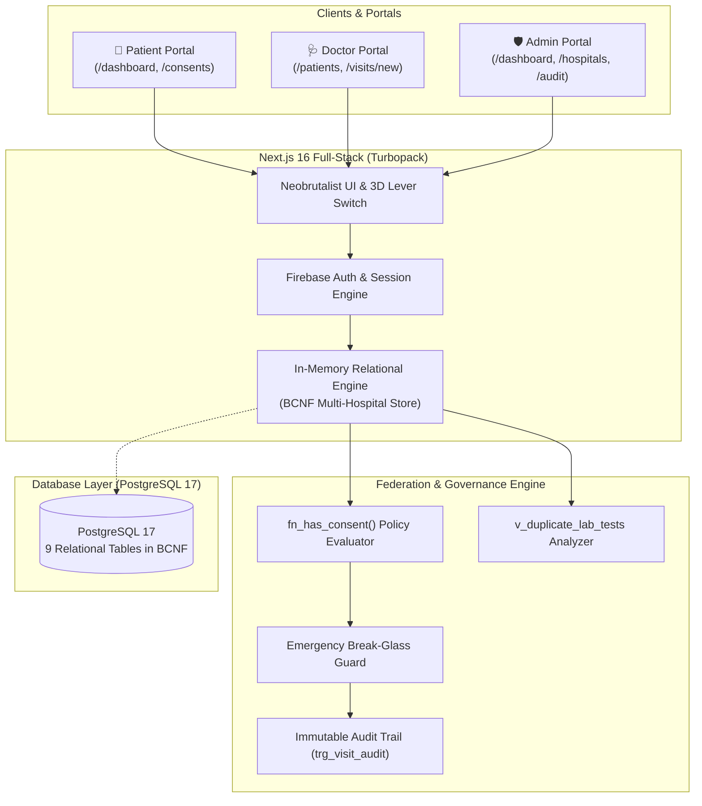
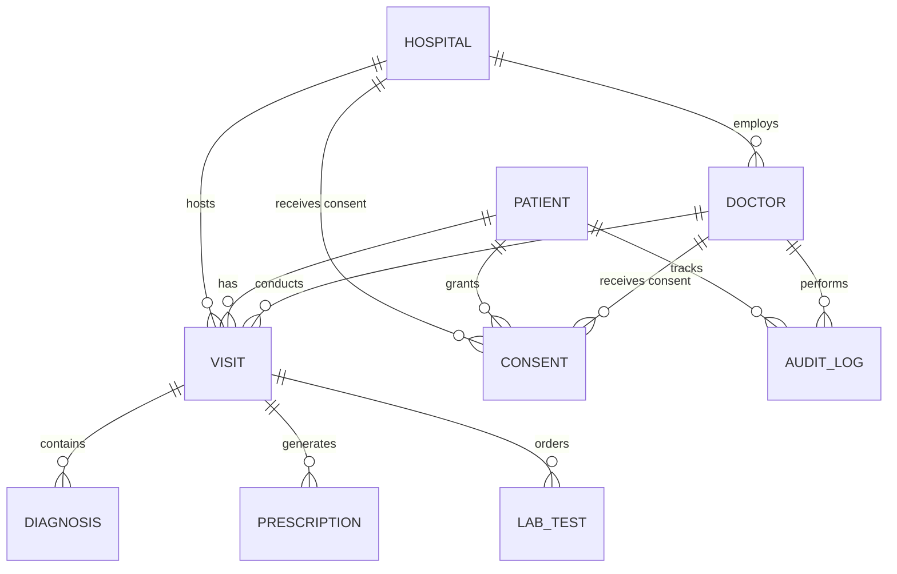

# AarogyaLink (आरोग्यLink)
 
> **Team:** Archit (25BRS1030) 

---

## 🌟 Overview

**AarogyaLink** is a unified digital health data exchange designed to solve the critical problem of fragmented medical histories across disparate hospital networks in India. 

Rather than locking patient data in proprietary hospital silos, AarogyaLink provides:
1. **One Unified Longitudinal Health Record:** A patient's complete history (diagnoses, prescriptions, and lab tests) travels with them across participating hospitals (e.g., Apollo Hospitals Chennai, Fortis Hospital Bengaluru, AIIMS New Delhi).
2. **Patient-Governed Dynamic Consent:** Patients have sole ownership over who can view their clinical chart, granting broad facility-level or narrow doctor-specific access with customizable expiry dates.
3. **Audited "Break-Glass" Emergency Access:** In life-threatening emergencies, doctors can bypass standard consent by providing mandatory clinical justification, which is instantly logged to a tamper-evident audit ledger.
4. **Cross-Hospital Duplicate Lab Test Detection:** Intelligent analytics automatically flag repeated investigations (e.g., HbA1c, Serum Creatinine, MRI) ordered within a 90-day window across different hospitals, preventing redundant costs and unnecessary procedures.

---

## 🏗️ System Architecture



---

## 🚀 Quick Start — How to Run

### Option 1: Run the Next.js Frontend (Quickest & Recommended)

The Next.js frontend includes an in-memory relational engine that accurately mirrors PostgreSQL BCNF schema, stored procedures, triggers, views, and Firebase authentication out of the box.

```bash
# 1. Navigate to the frontend directory
cd frontend

# 2. Install dependencies
pnpm install
# (or: npm install)

# 3. Start the development server
pnpm run dev
# (or: npm run dev)
```

Open your browser and navigate to:
👉 **[http://localhost:3000](http://localhost:3000)**

---

### Option 2: Run with Docker Compose (Full Stack)

To run the containerized application with **PostgreSQL 17**, the **FastAPI backend**, and **Next.js**:

```bash
# From the repository root:
docker compose up --build
```

* **Frontend:** [http://localhost:3000](http://localhost:3000)
* **Backend API:** [http://localhost:8000](http://localhost:8000)
* **PostgreSQL Database:** `localhost:5432` (Database: `aarogya_db`, User: `aarogya`, Password: `aarogya_dev_password`)

---

## 🔑 Authentication & Demo Credentials

AarogyaLink supports both **1-Click Instant Demo Persona Logins** and **Firebase Email/Password Authentication**.

### 1-Click Instant Demo Logins (On Login Card)

| Role | Persona Name | Email | Password | Access Scope |
| :--- | :--- | :--- | :--- | :--- |
| **Patient** | Karthik Iyer | `karthik.iyer@example.in` | `AarogyaLink@123` | View visits, medications, labs, manage consents |
| **Doctor** | Dr. Rohan Mehta | `rohan.mehta@example.in` | `AarogyaLink@123` | Cardiology @ Apollo Chennai (OPD / Chart access) |
| **Doctor** | Dr. Arjun Singh | `arjun.singh@example.in` | `AarogyaLink@123` | Emergency Medicine @ Fortis Bengaluru |
| **Admin** | Central Admin | `admin@aarogyalink.in` | `AarogyaLink@123` | Full network oversight, patient registry, audit log |

### Creating a New Account
* Click the **Create Account** tab on `/`.
* Choose your role: **Patient**, **Doctor**, or **Admin**.
* The role is automatically registered and permanently remembered for all subsequent sign-ins.
* Default temporary password for newly registered accounts: **`ArogyaLink@2026`** (or choose your own).

---

## 🎨 UI & Design System

AarogyaLink features a tactile **Neobrutalism** and modern charcoal design system:

* **Dark Charcoal & Gray Palette:**
  * Deep Background Base: `#121212`
  * Card / Container Layers: `#1C1C1C`
  * High-Contrast Borders: `#444444` / `#000000`
  * Primary Text: `#E0E0E0` (Silver-white)
  * Muted Text: `#B0B0B0`
  * Soft Gray Accent: `#888888`
* **3D Isometric Input Containers:** Tactile perspective inputs with uppercase badge headers and interactive password SHOW/HIDE visibility toggles.
* **3D Knife-Switch Dark Mode Toggle:** An interactive mechanical lever switch in the header that flips with 3D faceted geometry to switch themes.
* **Neobrutalist Tab Bar:**
  * 🚀 **Dashboard:** Cyan (`#06B6D4`)
  * 👥 **Patients / Registry:** Sky Blue (`#60A5FA`)
  * 🛡️ **Consent:** Amber (`#FACC14`)
  * 📜 **Audit Log:** Orange (`#FB923C`)
  * 🏥 **Hospitals:** Emerald (`#10B981`)
  * 🧪 **Duplicate Tests:** Purple (`#A855F7`)
  * ⬅️ **Back Button:** Includes hover-expanding text transition.

---

## 🗄️ Database Architecture & BCNF Schema

The relational schema is in **Boyce-Codd Normal Form (BCNF)** and enforces strict referential integrity.

### Entity Relationship Model



### Table Breakdown

| Table | Primary Key | Foreign Keys | Cascade | Description |
| :--- | :--- | :--- | :--- | :--- |
| `patient` | `patient_id` | — | RESTRICT | Patient demographics, contact info, unique email. |
| `hospital` | `hospital_id` | — | RESTRICT | Accredited hospital facilities and registration numbers. |
| `doctor` | `doctor_id` | `hospital_id` → `hospital` | RESTRICT | Doctors with license numbers and hospital affiliations. |
| `visit` | `visit_id` | `patient_id`, `hospital_id`, `doctor_id` | RESTRICT | Clinical encounter records (OPD, Emergency, Inpatient). |
| `diagnosis` | `diagnosis_id`| `visit_id` → `visit` | **CASCADE** | ICD-10 diagnostic codes and clinical notes. |
| `prescription`| `prescription_id`| `visit_id` → `visit`| **CASCADE** | Medications, dosage, frequency, and treatment course. |
| `lab_test` | `lab_test_id` | `visit_id` → `visit` | **CASCADE** | Diagnostic lab results, units, flags, and dates. |
| `consent` | `consent_id` | `patient_id`, `hospital_id` (opt), `doctor_id` (opt) | RESTRICT | Dynamic access policies (`Active` / `Revoked`). |
| `audit_log` | `log_id` | `patient_id`, `doctor_id` (opt) | RESTRICT / SET NULL | Immutable audit trail (`READ`, `INSERT`, `EMERGENCY_READ`, `DENIED`). |


---

## 📁 Repository Structure

```
arogya-link/
├── README.md                      # Project root documentation (this file)
├── docker-compose.yml             # Full-stack container orchestration
├── database/
│   └── init_migration_001.sql     # PostgreSQL migration script & seed data
├── docs/
│   ├── DATABASE_SCHEMA.md         # Detailed schema, relationships & DDL
│   ├── AarogyaLink_DA2_SQL_Queries.md # Complete SQL queries from DA2
│   └── 07_frontend_ui.md          # UI design system guidelines
├── frontend/                      # Next.js 16 Web Application
│   ├── src/
│   │   ├── app/                   # App Router pages & API routes
│   │   │   ├── (portal)/          # Authenticated layout, dashboard, patients, consents, audit
│   │   │   ├── api/               # API route handlers (/auth/session, /duplicates, etc.)
│   │   │   ├── globals.css        # Neo-brutalist styles, charcoal theme, 3D lever CSS
│   │   │   └── page.tsx           # Landing page with interactive Auth card
│   │   ├── components/            # UI Components (NavLinks, ThemeToggle, AuthCard, etc.)
│   │   └── lib/                   # Store, Firebase client, Session, Formatters, Actions
│   └── package.json
└── backend/                       # FastAPI Python Backend
    ├── main.py
    └── pyproject.toml
```

---

