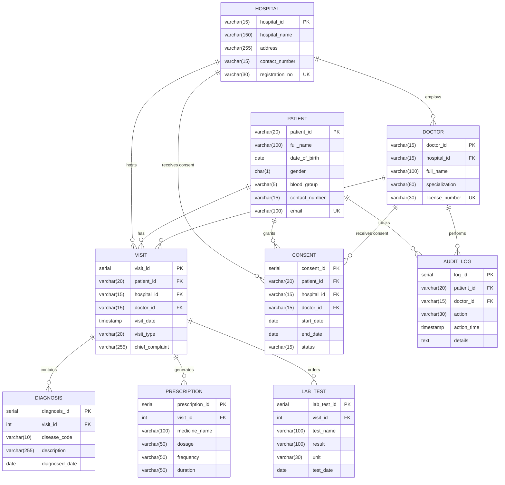

# AarogyaLink — Database Schema & Architecture Reference

This document provides the complete database schema, entity-relationship models, constraints, views, triggers, and relationship linkages for **AarogyaLink** — a federated, multi-hospital health data sharing platform.

---

## 1. Entity-Relationship Diagram (ERD)



---

## 2. Table Schemas & Data Dictionaries

### 2.1. `patient`
Stores globally unique patient master records. Patients own their health record and govern consent.

| Column | Type | Constraints | Description |
| :--- | :--- | :--- | :--- |
| `patient_id` | `VARCHAR(20)` | **PRIMARY KEY** | Unique global identifier (e.g. `PAT-IN-1001`) |
| `full_name` | `VARCHAR(100)` | `NOT NULL` | Patient's full legal name |
| `date_of_birth` | `DATE` | `NOT NULL` | Date of birth for age derivation |
| `gender` | `CHAR(1)` | `NOT NULL`, `CHECK (gender IN ('M', 'F', 'O'))` | Biological sex / gender identifier |
| `blood_group` | `VARCHAR(5)` | Nullable | Blood group (e.g., `A+`, `O-`, `B+`) |
| `contact_number`| `VARCHAR(15)` | `NOT NULL` | 10–15 digit mobile phone number |
| `email` | `VARCHAR(100)` | **UNIQUE**, Nullable | Email address for portal login & alerts |

```sql
CREATE TABLE patient (
  patient_id     VARCHAR(20)  PRIMARY KEY,
  full_name      VARCHAR(100) NOT NULL,
  date_of_birth  DATE         NOT NULL,
  gender         CHAR(1)      NOT NULL CHECK (gender IN ('M', 'F', 'O')),
  blood_group    VARCHAR(5),
  contact_number VARCHAR(15)  NOT NULL,
  email          VARCHAR(100) UNIQUE
);
```

---

### 2.2. `hospital`
Stores institutional entities participating in the AarogyaLink health data federation.

| Column | Type | Constraints | Description |
| :--- | :--- | :--- | :--- |
| `hospital_id` | `VARCHAR(15)` | **PRIMARY KEY** | Unique facility identifier (e.g. `HSP-01`) |
| `hospital_name` | `VARCHAR(150)` | `NOT NULL` | Hospital or clinic system name |
| `address` | `VARCHAR(255)` | `NOT NULL` | Physical facility street address & city |
| `contact_number`| `VARCHAR(15)` | `NOT NULL` | Facility telephone / PBX board number |
| `registration_no`| `VARCHAR(30)` | **UNIQUE**, `NOT NULL` | Government regulatory license / registration |

```sql
CREATE TABLE hospital (
  hospital_id     VARCHAR(15)  PRIMARY KEY,
  hospital_name   VARCHAR(150) NOT NULL,
  address         VARCHAR(255) NOT NULL,
  contact_number  VARCHAR(15)  NOT NULL,
  registration_no VARCHAR(30)  UNIQUE NOT NULL
);
```

---

### 2.3. `doctor`
Stores credentialed clinicians affiliated with hospitals.

| Column | Type | Constraints | Description |
| :--- | :--- | :--- | :--- |
| `doctor_id` | `VARCHAR(15)` | **PRIMARY KEY** | Unique physician identifier (e.g. `DOC-01`) |
| `hospital_id` | `VARCHAR(15)` | `NOT NULL`, **REFERENCES** `hospital(hospital_id)` | Primary affiliated hospital |
| `full_name` | `VARCHAR(100)` | `NOT NULL` | Physician's full name |
| `specialization`| `VARCHAR(80)` | `NOT NULL` | Medical department / specialty |
| `license_number`| `VARCHAR(30)` | **UNIQUE**, `NOT NULL` | State/National Medical Council registration |

```sql
CREATE TABLE doctor (
  doctor_id      VARCHAR(15)  PRIMARY KEY,
  hospital_id    VARCHAR(15)  NOT NULL REFERENCES hospital(hospital_id),
  full_name      VARCHAR(100) NOT NULL,
  specialization VARCHAR(80)  NOT NULL,
  license_number VARCHAR(30)  UNIQUE NOT NULL
);
```

---

### 2.4. `visit`
The central encounter hub linking the patient, attending clinician, and host hospital.

| Column | Type | Constraints | Description |
| :--- | :--- | :--- | :--- |
| `visit_id` | `SERIAL` | **PRIMARY KEY** | Auto-incrementing encounter sequence ID |
| `patient_id` | `VARCHAR(20)` | `NOT NULL`, **REFERENCES** `patient(patient_id)` | Patient who attended the visit |
| `hospital_id` | `VARCHAR(15)` | `NOT NULL`, **REFERENCES** `hospital(hospital_id)` | Hospital facility where visit occurred |
| `doctor_id` | `VARCHAR(15)` | `NOT NULL`, **REFERENCES** `doctor(doctor_id)` | Treating physician |
| `visit_date` | `TIMESTAMP` | `NOT NULL DEFAULT NOW()` | Date and timestamp of the encounter |
| `visit_type` | `VARCHAR(20)` | `NOT NULL`, `CHECK (visit_type IN ('OPD', 'Emergency', 'Inpatient'))` | Encounter classification |
| `chief_complaint`| `VARCHAR(255)`| Nullable | Presenting medical problem |

```sql
CREATE TABLE visit (
  visit_id        SERIAL      PRIMARY KEY,
  patient_id      VARCHAR(20) NOT NULL REFERENCES patient(patient_id),
  hospital_id     VARCHAR(15) NOT NULL REFERENCES hospital(hospital_id),
  doctor_id       VARCHAR(15) NOT NULL REFERENCES doctor(doctor_id),
  visit_date      TIMESTAMP   NOT NULL DEFAULT NOW(),
  visit_type      VARCHAR(20) NOT NULL CHECK (visit_type IN ('OPD', 'Emergency', 'Inpatient')),
  chief_complaint VARCHAR(255)
);
```

---

### 2.5. `diagnosis`
Diagnostic records tied directly to a clinical visit.

| Column | Type | Constraints | Description |
| :--- | :--- | :--- | :--- |
| `diagnosis_id` | `SERIAL` | **PRIMARY KEY** | Auto-incrementing diagnosis ID |
| `visit_id` | `INTEGER` | `NOT NULL`, **REFERENCES** `visit(visit_id) ON DELETE CASCADE` | Parent clinical visit |
| `disease_code` | `VARCHAR(10)` | `NOT NULL` | Standard ICD-10 diagnostic code (e.g. `E11.9`) |
| `description` | `VARCHAR(255)`| `NOT NULL` | Clinical description of diagnosis |
| `diagnosed_date`| `DATE` | `NOT NULL` | Date diagnosis was confirmed |

```sql
CREATE TABLE diagnosis (
  diagnosis_id   SERIAL       PRIMARY KEY,
  visit_id       INTEGER      NOT NULL REFERENCES visit(visit_id) ON DELETE CASCADE,
  disease_code   VARCHAR(10)  NOT NULL,
  description    VARCHAR(255) NOT NULL,
  diagnosed_date DATE         NOT NULL
);
```

---

### 2.6. `prescription`
Medications prescribed during an encounter.

| Column | Type | Constraints | Description |
| :--- | :--- | :--- | :--- |
| `prescription_id`| `SERIAL` | **PRIMARY KEY** | Auto-incrementing prescription ID |
| `visit_id` | `INTEGER` | `NOT NULL`, **REFERENCES** `visit(visit_id) ON DELETE CASCADE` | Parent clinical visit |
| `medicine_name`| `VARCHAR(100)`| `NOT NULL` | Drug brand/generic name |
| `dosage` | `VARCHAR(50)` | `NOT NULL` | Dosage strength (e.g. `500 mg`, `10 mg`) |
| `frequency` | `VARCHAR(50)` | `NOT NULL` | Administration schedule (e.g. `Twice daily after meals`) |
| `duration` | `VARCHAR(50)` | `NOT NULL` | Treatment duration (e.g. `14 days`, `30 days`) |

```sql
CREATE TABLE prescription (
  prescription_id SERIAL       PRIMARY KEY,
  visit_id        INTEGER      NOT NULL REFERENCES visit(visit_id) ON DELETE CASCADE,
  medicine_name   VARCHAR(100) NOT NULL,
  dosage          VARCHAR(50)  NOT NULL,
  frequency       VARCHAR(50)  NOT NULL,
  duration        VARCHAR(50)  NOT NULL
);
```

---

### 2.7. `lab_test`
Diagnostic laboratory investigations and findings.

| Column | Type | Constraints | Description |
| :--- | :--- | :--- | :--- |
| `lab_test_id` | `SERIAL` | **PRIMARY KEY** | Auto-incrementing lab result ID |
| `visit_id` | `INTEGER` | `NOT NULL`, **REFERENCES** `visit(visit_id) ON DELETE CASCADE` | Parent clinical visit |
| `test_name` | `VARCHAR(100)`| `NOT NULL` | Investigation name (e.g. `HbA1c`, `Serum Creatinine`) |
| `result` | `VARCHAR(100)`| Nullable | Numerical or qualitative result |
| `unit` | `VARCHAR(30)` | Nullable | Measurement unit (e.g. `mg/dL`, `%`) |
| `test_date` | `DATE` | `NOT NULL` | Date specimen was tested |

```sql
CREATE TABLE lab_test (
  lab_test_id SERIAL       PRIMARY KEY,
  visit_id    INTEGER      NOT NULL REFERENCES visit(visit_id) ON DELETE CASCADE,
  test_name   VARCHAR(100) NOT NULL,
  result      VARCHAR(100),
  unit        VARCHAR(30),
  test_date   DATE         NOT NULL
);
```

---

### 2.8. `consent`
Governs dynamic, patient-controlled data sharing permissions across hospitals and clinicians.

| Column | Type | Constraints | Description |
| :--- | :--- | :--- | :--- |
| `consent_id` | `SERIAL` | **PRIMARY KEY** | Auto-incrementing consent policy ID |
| `patient_id` | `VARCHAR(20)` | `NOT NULL`, **REFERENCES** `patient(patient_id)` | Granting patient |
| `hospital_id` | `VARCHAR(15)` | Nullable, **REFERENCES** `hospital(hospital_id)` | Target hospital (grants all doctors at hospital) |
| `doctor_id` | `VARCHAR(15)` | Nullable, **REFERENCES** `doctor(doctor_id)` | Specific target doctor |
| `start_date` | `DATE` | `NOT NULL` | Effective start date |
| `end_date` | `DATE` | Nullable | Expiry date (`NULL` = indefinite until revoked) |
| `status` | `VARCHAR(15)` | `NOT NULL`, `CHECK (status IN ('Active', 'Revoked'))` | Current consent state |

**Domain Constraints:**
- `CHECK (hospital_id IS NOT NULL OR doctor_id IS NOT NULL)`: Must target either a facility or an individual physician.
- `CHECK (end_date IS NULL OR end_date >= start_date)`: End date cannot precede start date.

```sql
CREATE TABLE consent (
  consent_id  SERIAL      PRIMARY KEY,
  patient_id  VARCHAR(20) NOT NULL REFERENCES patient(patient_id),
  hospital_id VARCHAR(15) REFERENCES hospital(hospital_id),
  doctor_id   VARCHAR(15) REFERENCES doctor(doctor_id),
  start_date  DATE        NOT NULL,
  end_date    DATE,
  status      VARCHAR(15) NOT NULL CHECK (status IN ('Active', 'Revoked')),
  CHECK (hospital_id IS NOT NULL OR doctor_id IS NOT NULL),
  CHECK (end_date IS NULL OR end_date >= start_date)
);
```

---

### 2.9. `audit_log`
Immutable, tamper-evident audit ledger capturing every access attempt, chart read, visit insert, and emergency "break-glass" override.

| Column | Type | Constraints | Description |
| :--- | :--- | :--- | :--- |
| `log_id` | `SERIAL` | **PRIMARY KEY** | Auto-incrementing audit sequence ID |
| `patient_id` | `VARCHAR(20)` | `NOT NULL`, **REFERENCES** `patient(patient_id)` | Patient record accessed |
| `doctor_id` | `VARCHAR(15)` | Nullable, **REFERENCES** `doctor(doctor_id)` | Clinician initiating the action |
| `action` | `VARCHAR(30)` | `NOT NULL` | `READ`, `INSERT`, `EMERGENCY_READ`, `DENIED`, etc. |
| `action_time` | `TIMESTAMP` | `NOT NULL DEFAULT NOW()` | Tamper-proof transaction timestamp |
| `details` | `TEXT` | Nullable | Contextual information or emergency justification |

```sql
CREATE TABLE audit_log (
  log_id      SERIAL      PRIMARY KEY,
  patient_id  VARCHAR(20) NOT NULL REFERENCES patient(patient_id),
  doctor_id   VARCHAR(15) REFERENCES doctor(doctor_id),
  action      VARCHAR(30) NOT NULL,
  action_time TIMESTAMP   NOT NULL DEFAULT NOW(),
  details     TEXT
);
```

---

## 3. How the Tables Are Linked

```
             ┌──────────────┐
             │   HOSPITAL   │
             └──────┬───────┘
                    │ 1
                    │
                    │ N
             ┌──────▼───────┐             ┌──────────────┐
             │    DOCTOR    │             │   PATIENT    │
             └──────┬───────┘             └──────┬───────┘
                    │ 1                          │ 1
                    │                            │
                    └───────────┬────────────────┘
                                │
                                │ N
                         ┌──────▼───────┐
                         │    VISIT     │
                         └──┬───┬───┬───┘
                            │   │   │
               ┌────────────┘   │   └────────────┐
             1 │              1 │              1 │
               │ N              │ N              │ N
        ┌──────▼───────┐ ┌──────▼───────┐ ┌──────▼───────┐
        │  DIAGNOSIS   │ │ PRESCRIPTION │ │   LAB_TEST   │
        └──────────────┘ └──────────────┘ └──────────────┘

  Cross-Cutting Governance:
  - CONSENT: Linked to PATIENT (1:N), optionally to HOSPITAL (0..1) or DOCTOR (0..1)
  - AUDIT_LOG: Linked to PATIENT (1:N), optionally to DOCTOR (0..1)
```

### Relational Linkage Summary

| Child Table | Foreign Key Column | Parent Table | Reference Column | Delete Rule | Business Meaning |
| :--- | :--- | :--- | :--- | :--- | :--- |
| `doctor` | `hospital_id` | `hospital` | `hospital_id` | RESTRICT | A doctor belongs to a verified hospital. |
| `visit` | `patient_id` | `patient` | `patient_id` | RESTRICT | A clinical encounter is tied to a unique patient. |
| `visit` | `hospital_id` | `hospital` | `hospital_id` | RESTRICT | Encounters take place at a specific hospital facility. |
| `visit` | `doctor_id` | `doctor` | `doctor_id` | RESTRICT | Encounters are conducted by a treating doctor. |
| `diagnosis` | `visit_id` | `visit` | `visit_id` | **CASCADE** | Diagnoses recorded during an encounter. Deleted if visit purged. |
| `prescription` | `visit_id` | `visit` | `visit_id` | **CASCADE** | Medications ordered during an encounter. Deleted if visit purged. |
| `lab_test` | `visit_id` | `visit` | `visit_id` | **CASCADE** | Lab tests performed for an encounter. Deleted if visit purged. |
| `consent` | `patient_id` | `patient` | `patient_id` | RESTRICT | Patient governs who can view their longitudinal records. |
| `consent` | `hospital_id` | `hospital` | `hospital_id` | RESTRICT | Optional broad consent granting all doctors at that facility. |
| `consent` | `doctor_id` | `doctor` | `doctor_id` | RESTRICT | Optional narrow consent granting a specific specialist. |
| `audit_log` | `patient_id` | `patient` | `patient_id` | RESTRICT | Every record inspection or update leaves a trail. |
| `audit_log` | `doctor_id` | `doctor` | `doctor_id` | SET NULL | Clinician responsible for the access or break-glass event. |

---

## 4. Key Views, Stored Functions & Triggers

### 4.1. Consent Verification Function (`fn_has_consent`)
Determines if a doctor currently has active authorization to read a patient's historical records:
```sql
CREATE OR REPLACE FUNCTION fn_has_consent(
  p_patient_id VARCHAR, p_doctor_id VARCHAR
) RETURNS BOOLEAN
LANGUAGE SQL STABLE AS $$
  SELECT EXISTS (
    SELECT 1
    FROM consent c
    JOIN doctor d ON d.doctor_id = p_doctor_id
    WHERE c.patient_id = p_patient_id
      AND c.status = 'Active'
      AND c.start_date <= CURRENT_DATE
      AND (c.end_date IS NULL OR c.end_date >= CURRENT_DATE)
      AND (c.doctor_id = p_doctor_id OR c.hospital_id = d.hospital_id)
  );
$$;
```

### 4.2. Automated Visit Audit Trigger (`trg_visit_audit`)
Automatically generates an immutable audit record whenever a new visit is recorded:
```sql
CREATE OR REPLACE FUNCTION trg_visit_audit() RETURNS TRIGGER
LANGUAGE plpgsql AS $$
BEGIN
  INSERT INTO audit_log (patient_id, doctor_id, action, details)
  VALUES (
    NEW.patient_id, NEW.doctor_id, 'INSERT',
    format('visit_id=%s type=%s hospital=%s', NEW.visit_id, NEW.visit_type, NEW.hospital_id)
  );
  RETURN NEW;
END;
$$;

CREATE TRIGGER visit_audit
AFTER INSERT ON visit
FOR EACH ROW EXECUTE FUNCTION trg_visit_audit();
```

---

## 5. How to Add a Patient in the Admin Dashboard

Administrators can register new patients into the global network with automatic ID generation (`PAT-IN-xxxx`).

### Method 1: Using the 1-Click Header Action (Fastest)
1. **Log in as Administrator**:
   - Go to `/` (Home / Login).
   - Click the **"Central Admin (Full network oversight)"** demo button, or sign in with admin credentials (`admin@aarogyalink.in`).
2. **Click "Register Patient"**:
   - On the top right of the **Network overview** dashboard, click the prominent **"Register patient"** button.
   - This directly opens `/patients?register=1#register` with the registration drawer automatically expanded.

### Method 2: From the Navigation Sidebar
1. While logged in as an Administrator, click **"Patients"** in the left sidebar navigation menu (`/patients`).
2. In the Patient Registry page, click either:
   - The top action button **"Register patient"**, OR
   - Scroll down to the bottom and click on the **"Register a new patient"** collapsible card.

### Step-by-Step Form Instructions
Fill in the following details in the registration form:

| Field | Required? | Example Value | Description |
| :--- | :--- | :--- | :--- |
| **Full name** | Yes | `Sunita Deshmukh` | Patient's complete name (max 100 characters). |
| **Date of birth** | Yes | `1985-06-15` | Must be a valid date in the past. |
| **Gender** | Yes | `Female` (`F`) | Choose Male, Female, or Other. |
| **Blood group** | No | `B+` | Select blood group from dropdown or leave as Unknown. |
| **Mobile number** | Yes | `9820011223` | 10 to 15 digits numeric phone number. |
| **Email** | Optional | `sunita.d@example.in` | Optional unique email for patient login. |

3. Click **"Register patient"**.
4. **Immediate Confirmation**:
   - A success banner displays: `Registered PAT-IN-1007. Login email: sunita.d@example.in (Temporary password: ArogyaLink@2026, or patient can set a custom password via Create Account). Ask the patient to grant consent before opening their chart.`
   - The new patient immediately appears in the Patient Registry table above with their masked ID, calculated age, and contact information.

---

### 5.1. Login Credentials for Registered Patients

When an administrator registers a patient:
1. **User Identifier**: The patient logs in using the **Email address** provided during registration (e.g. `sunita.d@example.in`).
2. **Password**:
   - **Default Initial Password**: `ArogyaLink@2026` (or `ArogyaLink@123`). The system automatically creates their Firebase account on their first login with this password.
   - **Custom Password**: The patient can also click the **"Create Account"** tab at any time, enter their email, and set their own personal password. Because their email is already in the database, AarogyaLink immediately connects them to their existing medical history and patient ID (`PAT-IN-xxxx`).

